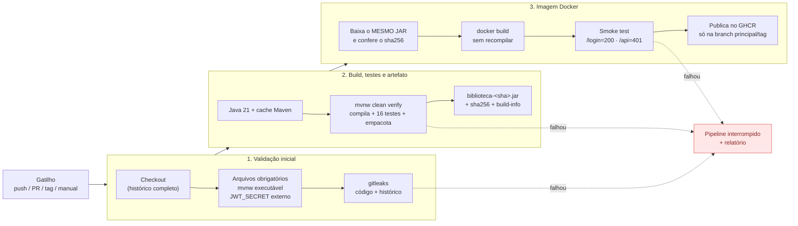
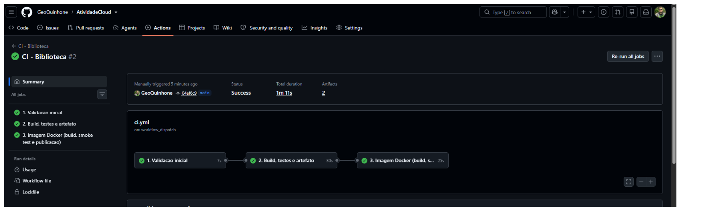
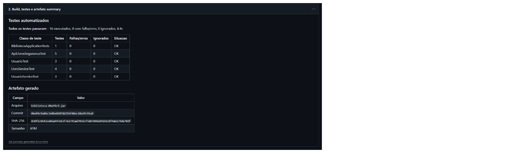
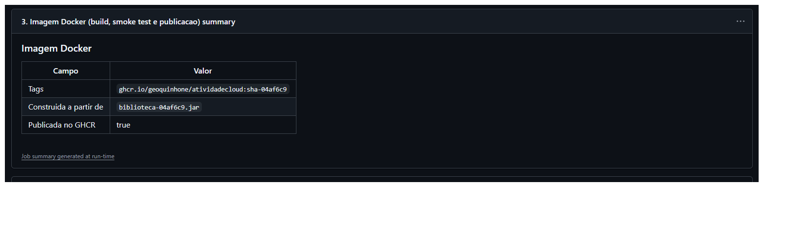
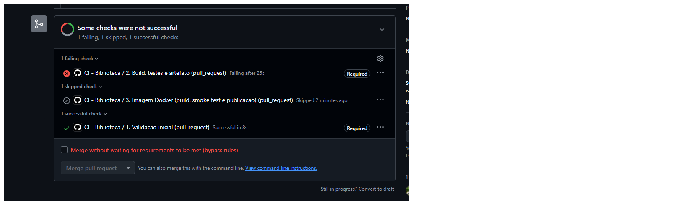
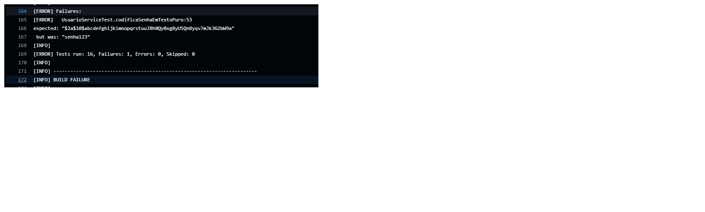
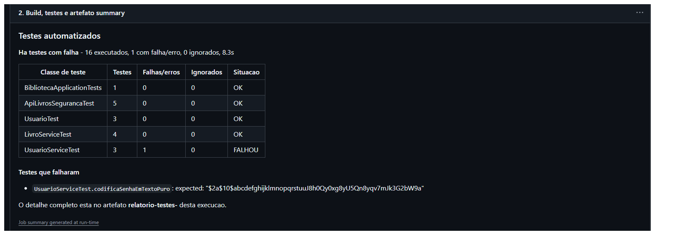

# Trabalho 5 — Pipeline CI mínimo e reprodutível

**Disciplina:** Cloud Computing e DevOps Avançado — CST em Sistemas para Internet (UniALFA)
**Professor:** Ranghetti
**Aplicação:** Biblioteca (Spring Boot 4.0.6, Java 21, Maven)
**Ferramenta de CI:** GitHub Actions
**Definição do pipeline:** [`.github/workflows/ci.yml`](../.github/workflows/ci.yml)

| Equipe |
|---|
| Geovane de Lucas Quinhone Ker |
| Romario Rodrigues |
| João Cintra |
| Leonardo Mirandola |
| Andrei Matos |

**Repositório:** `https://github.com/GeoQuinhone/AtividadeCloud` 

---

## 1. Visão geral

O pipeline transforma cada mudança no repositório em um resultado verificável: valida a estrutura e procura segredos, compila, executa os testes, gera um JAR identificado pelo commit e, a partir **desse mesmo JAR**, constrói e testa uma imagem Docker. Qualquer falha interrompe as etapas seguintes.



## 2. Gatilhos

| Evento | Quando | O que roda |
|---|---|---|
| `push` | em `master`/`main` | Tudo, incluindo a publicação da imagem no GHCR |
| `pull_request` | aberto/atualizado contra `master`/`main` | Validação, build, testes, artefato, imagem e smoke test — **sem publicar** (porta de qualidade do PR) |
| `push` de tag `v*` | ex.: `v1.0.0` | Tudo; a imagem recebe também a tag da versão |
| `workflow_dispatch` | botão **Run workflow** na aba Actions | Execução manual autorizada |

Deploy em produção **não** é disparado por nenhum evento (fora do escopo do T5). Um novo push na mesma branch cancela a execução anterior (`concurrency`), evitando filas.

## 3. Etapas (entrada, ação, saída, falha, evidência)

| # | Etapa | Entrada | Ação | Saída | O que interrompe | Evidência | Responsável |
|---|---|---|---|---|---|---|---|
| 1.1 | Checkout | Evento do GitHub | Obtém o commit exato (`fetch-depth: 0`) | Código no runner | Repositório inacessível | Log do job | Quem fez o push |
| 1.2 | Arquivos obrigatórios | Código | Confere `pom.xml`, `mvnw` (executável), wrapper, `Dockerfile`, e se o segredo JWT vem de `${JWT_SECRET}` | — | Arquivo ausente, `mvnw` sem permissão ou segredo escrito no arquivo | Anotação `::error` apontando o arquivo | Quem fez o push |
| 1.3 | Detecção de segredos | Código + **todo o histórico** | `gitleaks` v8.30.1 (download com checksum verificado) | Relatório | Qualquer segredo encontrado | Log (valores mascarados) + artefato `gitleaks-relatorio-<sha>` | Quem fez o push; segredo vazado deve ser **revogado** |
| 2.1 | Ambiente | Código | Java 21 (Temurin) + cache de dependências Maven | JDK pronto | Falha de download | Log | Equipe |
| 2.2 | Build e testes | Código | `./mvnw --batch-mode clean verify` (ambiente limpo, compila, roda todos os testes, empacota) | `target/biblioteca.jar` | Erro de compilação ou **qualquer** teste falhando | Log do Maven, **resumo dos testes** na página da execução, artefato `relatorio-testes-<sha>` | Autor da mudança |
| 2.3 | Identificação do artefato | JAR | Renomeia para `biblioteca-<sha7>.jar`, gera `.sha256` e `build-info.txt` | Pasta `dist/` | Arquivo não gerado | Tabela "Artefato gerado" no resumo | Equipe |
| 2.4 | Publicação do artefato | `dist/` | `upload-artifact` (retenção 30 dias) | Artefato `biblioteca-<sha7>` | Nenhum arquivo para enviar | Artefato baixável na execução | Equipe |
| 3.1 | Integridade | Artefato da etapa 2 | Baixa e confere o `sha256` | JAR verificado | Checksum diferente | Log | Equipe |
| 3.2 | Build da imagem | JAR verificado | `docker build --build-arg JAR_FILE=...` (**não recompila**) | `ghcr.io/<owner>/<repo>:sha-<sha7>` | Erro no Dockerfile | Log + labels OCI com o commit | Equipe |
| 3.3 | Smoke test | Imagem | Sobe o container com `JWT_SECRET` aleatório e testa `GET /login` (200) e `GET /api/livros` sem token (401) | — | App não sobe em 60 s ou status diferente | Log + `docker logs` em caso de falha | Equipe |
| 3.4 | Publicação | Imagem testada | `docker push` para o GHCR | Imagem no registro | Falha de autenticação/push | Pacote no GitHub + resumo "Imagem Docker" | Equipe |

**Escopo mínimo do enunciado:** checkout ✔ · build ✔ · testes ✔ · resultado visível ✔ · artefato identificado ✔
**Recomendados atendidos:** cache de dependências ✔ · construção de imagem ✔ · detecção de segredos ✔

## 4. Dependências

**Entre etapas:** `validacao` → `build-e-testes` → `imagem-docker` (cada job usa `needs`). Se uma etapa falha, as seguintes ficam como *skipped*.

**Ferramentas e versões (fixadas):**

| Item | Versão | Onde é definida |
|---|---|---|
| Runner | `ubuntu-latest` (GitHub) | `ci.yml` |
| Java | Temurin 21 | `ci.yml` (`JAVA_VERSION`) e `pom.xml` |
| Maven | 3.9.15 via Maven Wrapper | `.mvn/wrapper/maven-wrapper.properties` |
| Spring Boot | 4.0.6 | `pom.xml` |
| gitleaks | 8.30.1 (checksum SHA-256 conferido) | `ci.yml` (`GITLEAKS_VERSION`) |
| Imagem base | `eclipse-temurin:21-jre-alpine` | `Dockerfile` |
| Actions | `checkout@v7`, `setup-java@v6`, `upload-artifact@v7`, `download-artifact@v8` | `ci.yml` |

## 5. Artefato e rastreabilidade

Cada execução bem-sucedida produz:

- **`biblioteca-<sha7>.jar`** — o pacote executável; `<sha7>` são os 7 primeiros caracteres do commit.
- **`biblioteca-<sha7>.jar.sha256`** — checksum para conferir integridade.
- **`build-info.txt`** — commit completo, branch/tag, evento, quem disparou, link da execução, data UTC e versão do Java.
- **Imagem** `ghcr.io/<owner>/<repo>:sha-<sha7>` (e `:vX.Y.Z` em tags), com labels `org.opencontainers.image.revision` e `source`.

O JAR é construído **uma vez** e a imagem é feita a partir dele (o job 3 baixa o artefato e confere o checksum antes). Não existe tag genérica como única identificação: toda imagem carrega o commit.

| Pergunta (slide 46) | Onde está a resposta |
|---|---|
| Qual código gerou este artefato? | Nome do arquivo (`<sha7>`), `build-info.txt` (`commit=`), label `revision` da imagem |
| Qual pipeline fez o build? | `build-info.txt` (`execucao=` com o link) |
| Que testes foram executados? | Resumo da execução + artefato `relatorio-testes-<sha7>` |
| Qual versão está publicada? | Tags `sha-<sha7>` / `vX.Y.Z` no GHCR |
| Quando? | `data_utc` no `build-info.txt` e label `created` da imagem |

## 6. Testes automatizados

O projeto original tinha apenas `contextLoads`. Foram adicionados **16 testes** em 5 classes:

| Classe | Tipo | O que garante |
|---|---|---|
| `BibliotecaApplicationTests` | Integração | O contexto Spring sobe com a configuração completa |
| `UsuarioServiceTest` | Unitário (Mockito) | Senha em texto puro é codificada; hash BCrypt não é recodificado; edição sem senha mantém a senha do banco |
| `LivroServiceTest` | Unitário (Mockito) | Salvar, listar, buscar por id inexistente (exceção) e remover |
| `UsuarioTest` | Unitário | ADMIN → `ROLE_ADMIN`, demais → `ROLE_USER`; username é o login |
| `ApiLivrosSegurancaTest` | Integração HTTP (porta aleatória) | API sem token e com token inválido → 401; login gera JWT; com o token é possível cadastrar e listar livros; página web sem login redireciona para `/login`; `/login` é pública |

## 7. Como reproduzir

**No GitHub (forma oficial):** qualquer push na branch principal, PR, tag `v*` ou o botão **Actions → CI - Biblioteca → Run workflow**.

**Localmente (mesmas etapas):**

```bash
# Requisitos: Java 21. Docker e gitleaks são opcionais.
./scripts/ci-local.sh            # validação + build/testes + artefato em dist/
./scripts/ci-local.sh --docker   # ... + imagem e smoke test
```

**Executar a aplicação gerada:**

```bash
export JWT_SECRET="$(openssl rand -base64 48)"
java -jar dist/biblioteca-<sha7>.jar
# ou
docker run -p 8080:8080 -e JWT_SECRET="$JWT_SECRET" ghcr.io/<owner>/<repo>:sha-<sha7>
```

Outra equipe consegue reproduzir porque tudo está versionado no repositório: Java e Maven fixados (wrapper), dependências resolvidas pelo `pom.xml`, Dockerfile e pipeline no próprio repositório, e nenhum passo manual oculto.

## 8. Como investigar uma falha

1. Abra **Actions** e clique na execução com ❌. O grafo mostra **qual job** falhou; os seguintes aparecem como *skipped*.
2. Abra o job e o **step** marcado em vermelho. As anotações no topo apontam arquivo e motivo.
3. Por etapa:

| Onde falhou | Onde olhar | Causa comum |
|---|---|---|
| Arquivos obrigatórios | Anotação `::error` | `mvnw` sem `+x`, arquivo removido, segredo escrito no `application.properties` |
| Detecção de segredos | Log do gitleaks (regra, arquivo, linha, commit) + artefato `gitleaks-relatorio-<sha>` | Chave/token commitado. **Revogar o segredo**, removê-lo e reescrever o histórico se necessário |
| Build e testes | **Resumo dos testes** (lista o teste e a mensagem) → artefato `relatorio-testes-<sha>` com o XML/TXT completo | Regra de negócio alterada, teste desatualizado, erro de compilação |
| Smoke test | `docker logs` impresso no próprio step | `JWT_SECRET` ausente, porta, erro na inicialização |
| Publicação | Log do `docker push` | Permissão de pacote no GHCR |

4. Para reproduzir na máquina: `./scripts/ci-local.sh` ou `./mvnw test -Dtest=NomeDaClasseTest`.
5. Corrija, faça novo commit; o pipeline roda de novo automaticamente.

## 9. Proteção de segredos

| Segredo | Como é tratado |
|---|---|
| Chave de assinatura do JWT | Saiu do `application.properties`; agora é `api.security.token.secret=${JWT_SECRET}`. Sem a variável a aplicação **não inicia** (falha explícita). A validação inicial barra quem voltar a escrever o valor no arquivo |
| JWT no smoke test | Gerado na hora com `openssl rand`, mascarado no log (`::add-mask::`) e descartado ao fim do job |
| JWT nos testes | Valor fixo, de baixo valor e explicitamente "somente para testes", declarado nas próprias classes de teste |
| Credencial do GHCR | `GITHUB_TOKEN` temporário criado pelo GitHub a cada execução, passado por `--password-stdin` (nunca aparece no log) |
| Permissões | Padrão `contents: read`; `packages: write` só no job da imagem; PRs nunca publicam |
| Varredura | gitleaks em todo o histórico a cada execução, com `--redact` (não imprime o valor encontrado) |

> **Atenção:** o valor antigo da chave JWT continua no histórico do Git do repositório original. Ele deve ser tratado como **comprometido** e nunca reutilizado em nenhum ambiente.

## 10. Riscos e mitigações

| Risco | Mitigação no pipeline |
|---|---|
| Segredo exposto no repositório | gitleaks no histórico completo; segredo JWT externo; checagem do `application.properties` |
| Testes insuficientes | 16 testes cobrindo regras de senha, serviço de livros, autorização e fluxo JWT real via HTTP |
| Imagem sem versão única | Tag obrigatória `sha-<sha7>` + labels OCI com o commit |
| Artefato diferente entre etapas | Build único; job da imagem baixa o mesmo JAR e confere o SHA-256 |
| Executor com permissão excessiva | `contents: read` por padrão; `packages: write` apenas no job 3; nenhum segredo extra cadastrado |
| Ferramenta de terceiros adulterada | gitleaks com versão fixa e checksum conferido; actions em versões principais fixadas |
| Dependência indisponível | Cache Maven no `setup-java`; wrapper fixa a versão do Maven |
| Imagem que não sobe | Smoke test antes de publicar |
| Mudança quebrada chegando à branch principal | Pipeline roda em todo PR; regra de proteção exige os checks verdes para o merge |

## 11. Evidências

### 11.1 Execução bem-sucedida

- **Link da execução:** https://github.com/GeoQuinhone/AtividadeCloud/actions/runs/38578016317
- **Evento:** `push` na branch `main`
- **Commit:** [`04af6c9`](https://github.com/GeoQuinhone/AtividadeCloud/commit/04af6c9a6bc3e8be0187dd35bf48ec18a1fc91a9)
- **Resultado:** os 3 jobs concluídos com sucesso; 16 testes executados sem falhas; artefato `biblioteca-04af6c9.jar` gerado; imagem publicada no GHCR com a tag `sha-04af6c9`.

**Grafo da execução — os 3 jobs verdes**



**Resumo — testes e artefato gerado**



**Resumo — imagem Docker publicada**



### 11.2 Falha detectada

- **Link da execução:** https://github.com/GeoQuinhone/AtividadeCloud/actions/runs/38583379738
- **Pull request:** https://github.com/GeoQuinhone/AtividadeCloud/pull/1
- **O que foi alterado:** na branch `demo/falha-senha`, foi comentada a linha que codifica a senha em `UsuarioService.salvar`. Com isso, a senha passaria a ser gravada em texto puro.
- **Onde o pipeline parou:** job **2. Build, testes e artefato**, step **Build e testes**. O teste `UsuarioServiceTest.codificaSenhaEmTextoPuro` falhou (esperado o hash BCrypt, recebido `senha123`): 16 testes executados, 1 falha, `BUILD FAILURE`. O job **3. Imagem Docker** ficou como *skipped*: nenhum JAR nem imagem foi gerado.
- **Resultado:** o merge do PR ficou bloqueado pelo check obrigatório, e o defeito foi descoberto **antes** de chegar à branch principal. O PR foi fechado sem merge.

**PR com o check falhando e o merge bloqueado**



**Log do Maven com o teste que falhou**



**Resumo dos testes mostrando a falha**



## 12. Checklist do Trabalho 5 (slide 67)

| Pergunta | Resposta |
|---|---|
| O repositório pode ser acessado pelo professor? | _(confirmar: público ou professor adicionado)_ |
| O pipeline possui um gatilho compreensível? | Sim — seção 2 |
| O build parte de ambiente limpo? | Sim — runner novo a cada execução + `mvnw clean verify` |
| Testes são executados? | Sim — 16 testes, resumo na página da execução |
| Uma falha interrompe corretamente o fluxo? | Sim — jobs encadeados por `needs`; evidência na seção 11.2 |
| O artefato possui identificação? | Sim — `biblioteca-<sha7>.jar` + checksum + `build-info.txt` |
| A execução pode ser associada ao commit? | Sim — nome do artefato, `build-info.txt`, tag e labels da imagem |
| Logs e evidências estão disponíveis? | Sim — logs, resumo, artefatos (30 dias) e relatórios de teste |
| Não existem segredos no repositório ou nos logs? | Sim — seção 9; gitleaks e mascaramento |
| Outra equipe conseguiria reproduzir? | Sim — seção 7 |